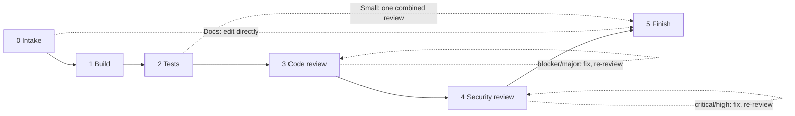

# ship-change

A Claude Code plugin that delivers a code change end to end through a gated pipeline:

1. **Intake**: read the requirement and the project's conventions.
2. **Build**: write the change.
3. **Tests**: `ship-test-writer` writes tests from the requirement, independent of how the code was built.
4. **Code review + fix**: `ship-code-reviewer` returns severity-ranked findings; you triage and fix.
5. **Security review + fix**: `ship-security-reviewer` checks the diff against a security checklist.
6. **Finish**: final report with review tables and a "Not verified" list.

Tests and reviews go to fresh-context subagents so they check what the code *does*, not what its author *meant*. Works in any repository and language.

<details>
<summary><strong>Pipeline flowchart</strong> (click to expand)</summary>



Commits are always the user's call: the skill asks at each commit point and never pushes, opens PRs, merges or deploys unasked.

</details>

## Contents

```
.claude-plugin/        plugin.json, marketplace.json
skills/ship-change/
  SKILL.md             the orchestrator
  references/          pipeline, checklists, test guide, profile template
  agents/              ship-test-writer, ship-code-reviewer, ship-security-reviewer
```

## Install

From a local checkout:

```
/plugin marketplace add /path/to/ship-change
/plugin install ship-change@ship-change
```

From GitHub:

```
/plugin marketplace add nanaaikinson/ship-change
/plugin install ship-change@ship-change
```

### skills.sh

```
npx skills add nanaaikinson/ship-change
```

The CLI copies the whole skill folder, including `agents/`, so the agent prompts come along. It does not register them as named subagents, so the skill hands them to generic subagents by file path instead. To get the named Claude Code agents too, copy them once:

```
mkdir -p ~/.claude/agents
cp <skill dir>/agents/*.md ~/.claude/agents/
```

### Manual

Copy `skills/ship-change` to `~/.claude/skills/`, and `skills/ship-change/agents/*.md` to `~/.claude/agents/` for named agents.

## Other agents

The skill follows the open Agent Skills format, so `npx skills add` can install it for Codex, Cursor, OpenCode and other agents. Untested outside Claude Code. What to expect:

- **Subagents available:** the skill tells the agent to spawn one per phase, each starting with "Read `agents/<name>.md` and act as that agent". Tests and reviews stay independent.
- **No subagents:** the skill does every phase itself, re-reading the diff from scratch for each review, and says in the report that the reviews were not independent.
- **Claude-only tools** (`AskUserQuestion`, `SendMessage`) have plain-text or "equivalent" fallbacks in the skill.
- The per-project profile lives at `.claude/ship-change.md` whatever the agent; it is just a file the skill reads.

## Usage

Ask Claude to implement, fix or refactor something and have it tested and reviewed: "ship this", "implement FR-12", "fix this properly". The skill triggers on its own.

## Per-project profile

The skill adapts to your repo's `CLAUDE.md`, `AGENTS.md`, `CONTRIBUTING` and build files. For tighter control, add `.claude/ship-change.md` (commands, requirement sources, sensitive areas, branching, safety rules). Template: `skills/ship-change/references/profile-template.md`. After the first run the skill offers to generate one.

## License

MIT
