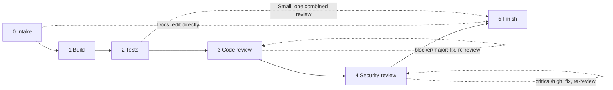

# ship-change

An agent skill that delivers a code change end to end through a gated pipeline:

1. **Intake**: read the requirement and the project's conventions.
2. **Build**: write the change.
3. **Tests**: `ship-test-writer` writes tests from the requirement, independent of how the code was built.
4. **Code review + fix**: `ship-code-reviewer` returns severity-ranked findings; the orchestrating agent triages and fixes them.
5. **Security review + fix**: `ship-security-reviewer` checks the diff against a security checklist.
6. **Finish**: final report with review tables and a "Not verified" list.

Tests and reviews go to separate agents that don't know how the code was written, so they check what it *does*, not what its author *meant*. Works in any repository and language.

Nothing is committed without asking: at each commit point the skill asks, and you can opt in to auto-commit for the rest of that run. It never pushes, opens PRs, merges or deploys unless you ask.

<details>
<summary><strong>Pipeline flowchart</strong> (click to expand)</summary>



</details>

## Install

### Any agent (skills.sh)

```
npx skills add nanaaikinson/ship-change
```

This uses the [skills CLI](https://skills.sh) and installs the skill for the agents you pick, including its bundled agent prompts. See [Using it with other agents](#using-it-with-other-agents).

### Claude Code plugin

Adds the three reviewers as named subagents.

```
/plugin marketplace add nanaaikinson/ship-change
/plugin install ship-change@ship-change
```

From a local checkout, use the checkout path instead of `nanaaikinson/ship-change`.

### Manual

Copy `skills/ship-change` into your agent's skills directory (for Claude Code, `~/.claude/skills/`). To get the reviewers as named Claude Code subagents, also copy `skills/ship-change/agents/*.md` to `~/.claude/agents/`.

## Usage

Ask your agent to implement, fix or refactor something and have it tested and reviewed: "ship this", "implement FR-12", "fix this properly". The skill triggers on its own.

## Using it with other agents

Built on the open Agent Skills format, so the skills CLI can install it for Codex, Cursor, OpenCode and other agents. It has been tested only in Claude Code. What to expect elsewhere:

- **Subagents available:** the skill spawns one per phase, each told to read `agents/<name>.md` and act as that agent. Tests and reviews stay independent.
- **No subagents:** the skill does every phase itself, re-reading the diff from scratch for each review, and says in the report that the reviews were not independent.
- **Claude Code–specific tools** (`AskUserQuestion`, `SendMessage`) have plain-text or equivalent fallbacks.

## Per-project profile

The skill adapts to your repo's `CLAUDE.md`, `AGENTS.md`, `CONTRIBUTING` and build files. For tighter control, add `.claude/ship-change.md` (commands, requirement sources, sensitive areas, branching, safety rules). It is a plain file the skill reads, so it works the same in any agent. Template: `skills/ship-change/references/profile-template.md`. After the first run the skill offers to generate one.

## Contents

```
.claude-plugin/        Claude Code plugin and marketplace manifests
skills/ship-change/
  SKILL.md             the orchestrator
  references/          pipeline, checklists, test guide, profile template
  agents/              ship-test-writer, ship-code-reviewer, ship-security-reviewer
```

## License

MIT
