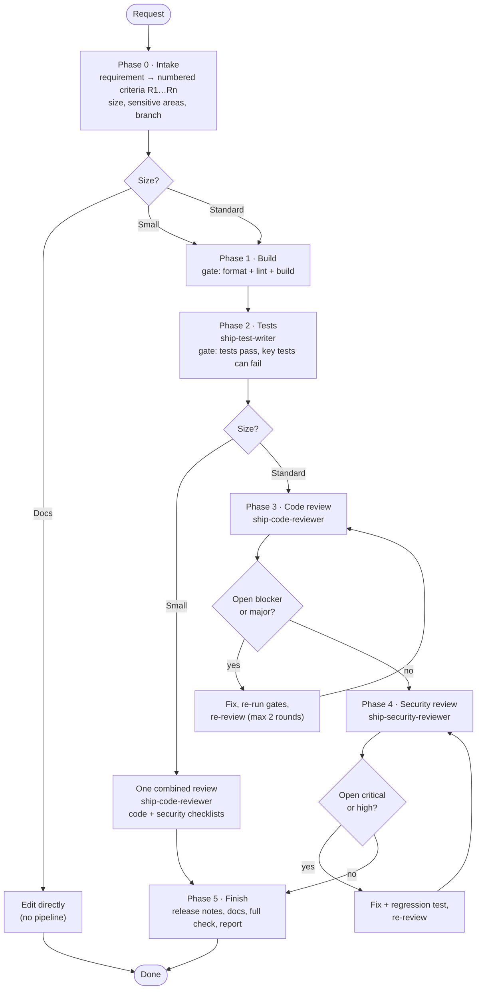

# ship-change

A Claude Code plugin that delivers a code change end to end through a gated pipeline:

1. **Intake**: read the requirement and the project's conventions.
2. **Build**: write the change.
3. **Tests**: `ship-test-writer` writes tests from the requirement, independent of how the code was built.
4. **Code review + fix**: `ship-code-reviewer` returns severity-ranked findings; you triage and fix.
5. **Security review + fix**: `ship-security-reviewer` checks the diff against a security checklist.
6. **Finish**: final report with review tables and a "Not verified" list.

Tests and reviews go to fresh-context subagents so they check what the code *does*, not what its author *meant*. Works in any repository and language.

## Pipeline



Commits are always the user's call: the skill asks at each commit point and never pushes, opens PRs, merges or deploys unasked.

## Contents

```
.claude-plugin/        plugin.json, marketplace.json
skills/ship-change/    SKILL.md + references/ (pipeline, checklists, test guide, profile template)
agents/                ship-test-writer, ship-code-reviewer, ship-security-reviewer
```

## Install

From a local checkout:

```
/plugin marketplace add /path/to/ship-change
/plugin install ship-change@ship-change
```

From GitHub:

```
/plugin marketplace add nanaaikinson/ship-change
/plugin install ship-change@ship-change
```

Manual install without the plugin system: copy `skills/ship-change` to `~/.claude/skills/` and `agents/*.md` to `~/.claude/agents/`.

## Usage

Ask Claude to implement, fix or refactor something and have it tested and reviewed: "ship this", "implement FR-12", "fix this properly". The skill triggers on its own.

## Per-project profile

The skill adapts to your repo's `CLAUDE.md`, `AGENTS.md`, `CONTRIBUTING` and build files. For tighter control, add `.claude/ship-change.md` (commands, requirement sources, sensitive areas, branching, safety rules). Template: `skills/ship-change/references/profile-template.md`. After the first run the skill offers to generate one.

## License

MIT
